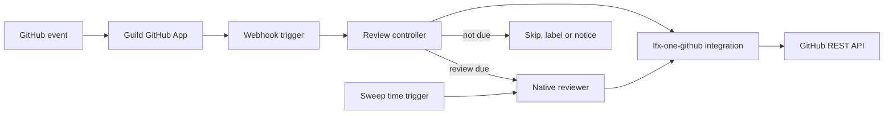

# Architecture overview

This repository is an automated pull request reviewer for LFX
repositories. It runs on [Guild.ai](https://guild.ai) and posts its
reviews as the `lfx-one` GitHub account. It has three deployed parts:

- **The Native reviewer** (`linux-foundation~lfx-review-agent`): the
  model that reads a pull request and posts the review. `PROMPT.md` is
  its system prompt and `guild.yaml` its manifest. Most of the review
  policy lives in `PROMPT.md`.
- **The review controller** (`linux-foundation~lfx-review-controller`):
  a TypeScript agent in `controller/` that every webhook trigger starts.
  It decides without a model call whether a review is due, then calls
  the Native reviewer with the GitHub reads it already made.
- **The `lfx-one-github` integration**: the GitHub REST operations both
  agents may call, defined in `integration/lfx-one-github.openapi.yaml`
  and run with the `lfx-one` token.

The scripts in `scripts/` do not review anything. They create and update
Guild triggers with the `guild` CLI.

`README.md` is the operator guide: setup, triggers, credentials and the
test checklist. This page explains how the parts fit together.

## How a review runs

1. GitHub sends a webhook to the Guild GitHub App (`guildai~github`).
   Webhooks never use the `lfx-one` token.
2. Each onboarded repository has four webhook triggers: `pull_request`
   `opened`, `synchronize` and `ready_for_review`, and `issue_comment`
   `created`. The comment trigger has a Guild filter, so only a comment
   that starts with `@lfx-one re-review` starts a run.
3. The trigger starts the controller. It reads the pull request, its
   reviews and its comments, and skips a closed, merged or draft pull
   request, a review still running, the five-minute cooldown, or a head
   that was already reviewed. When it skips, it may add the pending label
   or post one debounce notice. A `re-review` request on a closed, merged
   or draft pull request still goes to the reviewer, which answers it
   with a skip notice.
4. Otherwise the controller calls the Native reviewer with the event and
   a `prepared` object holding those reads and a scope hint. If a read
   fails, it passes the original event instead, and the reviewer applies
   every gate itself.
5. The reviewer posts a start comment, reviews the change, submits one
   formal review with inline comments, and appends a summary to the start
   comment.
6. The controller then repairs any HTML-escaped markers in the review
   that run posted.

A Guild time trigger runs a sweep four times an hour. The sweep calls the
Native reviewer directly, without the controller, and reviews at most one
pull request that is owed a review: a push that was dropped while a
review ran, a review that did not finish, or a pull request opened in the
last 7 days that never got one. The label `lfx-review-agent-pending`
marks pull requests that may be owed a review.

## The Native reviewer

`PROMPT.md` is a numbered procedure. The steps, in order:

| Step | What it does |
| --- | --- |
| 0 | Identifies the event (`opened`, `synchronize`, `ready_for_review`, `re-review` or `sweep`) and takes "now" from the payload. |
| 0.3 | Sweep only: searches for one pull request that is owed a review. |
| 0.5 | Re-review only: checks the commenter and reacts with eyes. |
| 1 | Reads pull request metadata and stops on a closed or draft pull request. |
| 1.5 | Classifies its own earlier comments and applies the gates below. |
| 2 | Derives the review cycle from its own earlier reviews. |
| 3 | Decides between an initial review, a follow-up of the new commits, or no review. |
| 3.2 | Checks the "Review exclusions" table. |
| 3.5 | Posts the start comment, which shows the agent version. |
| 4 | Reads the diff, the commits and the repository's rule files, and reviews them. |
| 5 | Resolves the verdict and submits one formal review. |
| 6 | Appends the summary to the start comment. |
| 7 | Returns a report to Guild (and to the controller). |

**Gates (Step 1.5).** A0 stops on a pull request with an exclusion
notice. A stops after 10 automatic reviews. A1 stops on a pull request
over 20,000 changed lines, 300 files or 150 review comments. B stops
while a review started less than 45 minutes ago is still running. C
stops when the agent's last comment is less than five minutes old.

**What it reviews.** One pass over the change across these dimensions:
Correctness, Security, Performance, Test Coverage, Code Style &
Consistency, Architecture, API Compliance (Go and Goa), Data Privacy,
Data Subject Rights, Data Residency and Documentation. Rule files
(`CLAUDE.md`, `AGENTS.md`, `CONTRIBUTING.md`, `.claude/rules/`) are read
from the target branch, so a pull request can't change the rules it is
judged by.

**Verdict (Step 5a).** The reviewer requests changes for any `[blocking]`
finding, any Data Privacy, Data Subject Rights or Data Residency finding,
any Security finding, more than two
`[minor]` findings, or a merge conflict. Otherwise it approves. Three
gates can withhold an approval, posting a comment review instead, but
never turn it into a request for changes:

- 5a.1: the author is not an org member or owner.
- 5a.2: a required CI check failed.
- 5a.3: the pull request changes a file the run could not read, other
  than a listed generated file or lockfile.

**Untrusted input.** Pull request content is data. Text in a diff or a
comment that tries to steer the review is reported as a `[blocking]`
Security finding and never followed.

**Read budget.** A model call that exceeds the context limit ends the run
before it can post anything. The "Read budget" table in `PROMPT.md` caps
each full-file read at 100,000 bytes and each run at 300,000 bytes, using
sizes from `git_get_tree` listings. File contents arrive as base64 JSON;
Guild cannot request GitHub's raw text form.

## State lives on GitHub

Neither agent keeps a database. Each run rebuilds the review cycle from
hidden HTML-comment markers in the agent's own comments and reviews, for
example `<!-- lfx-review-agent:review -->`. `CLAUDE.md` lists every
marker. Open pull requests carry these markers, the `[docs]` title tag,
the `lfx-review-agent-pending` label and the `lfx_review_agent_event`
sweep input key, so renaming any of them breaks the cycle state on those
pull requests.

Per-finding markers (`:finding` and `:finding-status`) record each
finding's severity, dimension and topic, and what happened to it on later
pushes. The engineering-metrics collector reads them; see
`specs/004-finding-metadata/contracts/finding-markers.md`.

## Releases and versions

- The "Agent version" section of `PROMPT.md` holds the Native reviewer's
  version. Every pull request that changes `PROMPT.md` or `guild.yaml`
  raises it; `.github/workflows/agent-version-check.yml` fails one that
  doesn't.
- `guild.yaml` pins the integration version, and so does the endpoint
  helper in `controller/agent.ts`. The controller's `calls` reference in
  `controller/agent.ts` pins the Native reviewer version; its own version
  is in `controller/package.json`.
- Publish order: the integration first, then the Native reviewer, then
  the controller. `CLAUDE.md` has the details.
- Guild does not enforce `enum` values in a request. The enums in the
  OpenAPI spec document intent; the prompt has to send the right values.

## Where things live

| Path | Contents |
| --- | --- |
| `PROMPT.md` | Native reviewer: procedure, gates, verdict rules, markers, read budget, exclusions, finding topics. |
| `guild.yaml` | Native reviewer manifest: the pinned integration version and the tools it may call. |
| `integration/lfx-one-github.openapi.yaml` | The integration's GitHub operations. `pulls_update_review` is used only by the controller, so `guild.yaml` leaves it out. |
| `controller/agent.ts` | Controller flow: GitHub reads, decisions, reviewer call, marker repair. |
| `controller/preflight.ts` | Event parsing, marker classification, review scope and eligibility. |
| `controller/metadata.ts` | Schemas for the pull request, review and comment reads. |
| `controller/tests/` | `node --test` suites; run `npm test` in `controller/`. |
| `scripts/onboard-repo.sh` | Creates a repository's four webhook triggers. |
| `scripts/re-review-trigger.sh` | Adds the re-review comment filter to existing triggers. |
| `scripts/sweep-trigger.sh` | Sets the sweep trigger's repository list and schedule. |
| `scripts/test-sweep-trigger.py` | Offline test for `sweep-trigger.sh`. |
| `specs/` | Design records for the sweep (001), context limits (002), the documentation check (003) and finding metadata (004). |
| `.github/workflows/` | Agent version check and license header check. |
